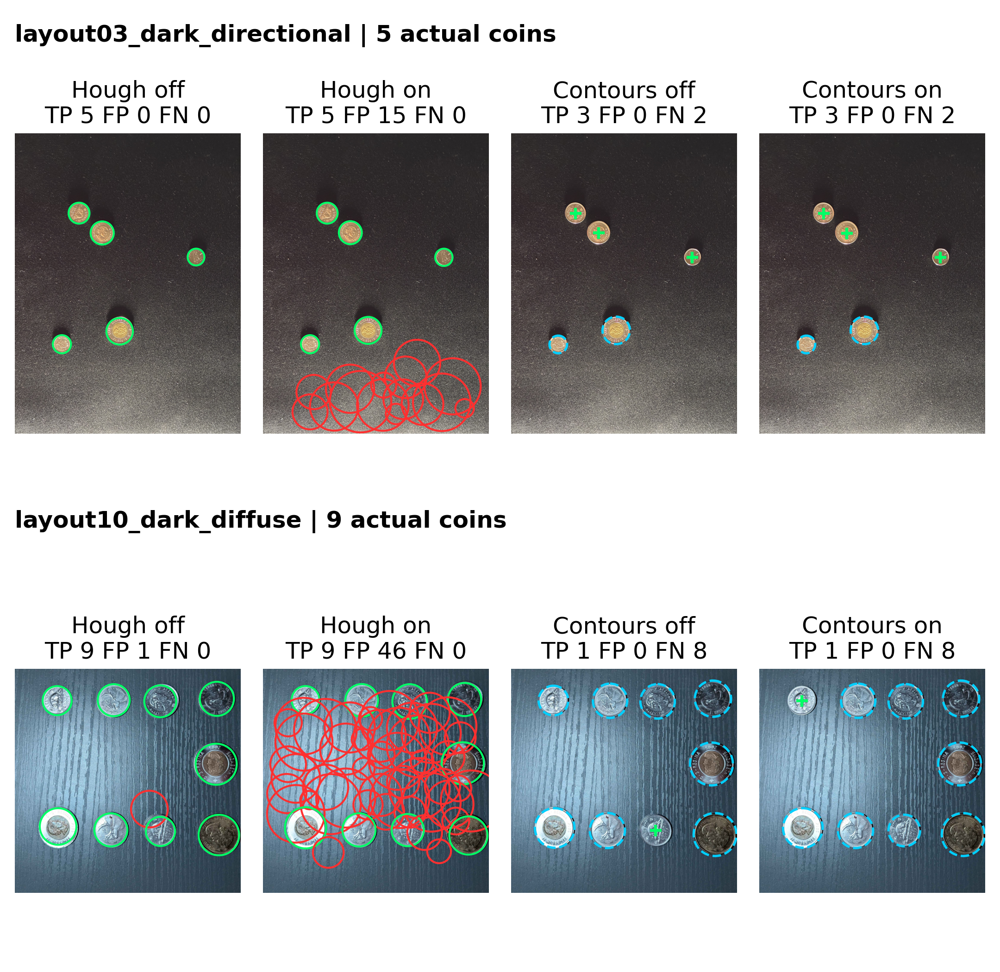

November 22, 2026. Kevin Zavitz; Haseeb Siddiqi; Andrew Lin; Sinthujan Jayaranjan; Camilo Castro-Espinel. Member-specific contributions require group confirmation.

### 1. Project topic

Coin Detection and Counting Across Lighting and Background Conditions. The goal is to locate visible coins and count them, comparing classical image-processing methods across controlled capture conditions. Denomination and monetary-value recognition are outside this implementation.

### 2. Proposal recap

We compare gradient Hough Circle Detection [1] with Otsu thresholding, morphological cleanup and external-contour detection [2-6]. Each method runs with CLAHE disabled and enabled [7], producing four configurations. The planned dataset has 40 arrangements photographed under two backgrounds and three lighting conditions (240 photographs). Touching and separated coins will be reported separately.

### 3. Progress so far

Working detectors, label conversion, split-aware runners, one-to-one matching, count/detection metrics, timing, CSV summaries, plots and a report builder are implemented. Twenty software tests passed, including exhaustive checks of small matching problems and synthetic detector/coordinate checks. These are implementation checks, not additional photo evidence. Raw VIA exports [9] are retained, including the three supplied replacements.

### 4. Dataset available now

Layouts 01-04 and 09-12 supply 48 readable photographs and 420 annotated coin instances: 20% of the planned photographs, representing only eight distinct arrangements. Development uses layouts 01, 03, 04, 09, 10 and 11 (36 photos, 306 instances). Validation uses layouts 02 and 12 (12 photos, 114 instances). All available arrangements contain separated coins.

All six photos from an arrangement remain in one split. The full manifest reserves 28/4/8 arrangements for development/validation/test (168/24/48 photos). Independent human review and annotator identities are pending for all 48 supplied labels; all reported scores are provisional. No final-test or touching-coin images were evaluated.

---

### 5. Preliminary results: numeric evaluation

A match requires a detected centre within half the labelled coin radius. The assignment maximizes the number of valid one-to-one matches, then minimizes total pixel distance [8]. Precision, recall and F1 aggregate coin detections. MAE is mean absolute count error per photo; Exact is the percentage of photos with the correct count. Coin identification can fail even when total counts agree.

### Development: 36 photos / 6 arrangements

| Method / CLAHE | P | R | F1 | MAE | Exact | ms |
| --- | --- | --- | --- | --- | --- | --- |
| Hough off | 0.993 | 0.958 | 0.975 | 0.417 | 75.0% | 52.3 |
| Hough on | 0.756 | 0.980 | 0.853 | 2.861 | 77.8% | 71.4 |
| Contours off | 0.959 | 0.608 | 0.744 | 3.111 | 25.0% | 37.0 |
| Contours on | 0.928 | 0.676 | 0.783 | 2.306 | 30.6% | 41.7 |

### Validation: 12 photos / 2 arrangements

| Method / CLAHE | P | R | F1 | MAE | Exact | ms |
| --- | --- | --- | --- | --- | --- | --- |
| Hough off | 0.991 | 0.947 | 0.969 | 0.583 | 66.7% | 55.3 |
| Hough on | 0.838 | 0.956 | 0.893 | 2.167 | 66.7% | 64.6 |
| Contours off | 0.953 | 0.719 | 0.820 | 2.333 | 33.3% | 40.1 |
| Contours on | 0.922 | 0.728 | 0.814 | 2.000 | 41.7% | 44.4 |

A development-only search tried Hough accumulator thresholds 35, 45, 55 and 65, and contour circularity cutoffs 0.50, 0.65 and 0.80. Highest mean F1 across CLAHE off/on selected 65 and 0.50. These settings were then fixed for both variants and the validation run. Development scores reuse search images and are optimistic exploratory measurements.

Hough without CLAHE has the highest validation F1 (0.969). Hough with CLAHE gives slightly higher recall, but 21 false positives versus 1 without CLAHE. Contours miss more coins. CLAHE improves development contour F1 but does not improve validation contour F1; two validation arrangements are insufficient for a general conclusion.

Timing: one OpenCV thread, three warm-ups and ten timed repeats per image; table shows the median of per-image medians. Resize/preprocessing/detection are timed; disk I/O, drawing and evaluation are excluded. Max image side is 1200; predictions are restored to original coordinates. Timings were measured on Linux, AMD EPYC 9V74, Python 3.12.14 / OpenCV 5.1.0, not on a group member's Mac.

---

### 5. Preliminary results: conditions and capture groups

Development F1 by background and lighting. Each row contains six photographs of six arrangements (51 coin instances). These photographs are correlated across conditions, so they must not be treated as 36 independent arrangements.

| Condition | Hough off | Hough on | Contours off | Contours on |
| --- | --- | --- | --- | --- |
| dark / diffuse | 0.981 | 0.546 | 0.522 | 0.725 |
| dark / dim | 1.000 | 1.000 | 0.903 | 0.948 |
| dark / directional | 0.970 | 0.872 | 0.478 | 0.583 |
| light / diffuse | 1.000 | 1.000 | 0.756 | 0.800 |
| light / dim | 0.903 | 0.959 | 0.980 | 0.948 |
| light / directional | 0.990 | 0.990 | 0.674 | 0.633 |

The largest Hough+CLAHE failure occurs on dark/diffuse development photos: F1 is 0.546, with 82 false positives and one missed coin. This is consistent with enhanced background/detail edges generating extra circle candidates; the comparison image on the next page documents an example. This is an observed association, not an isolated causal test of surface texture.

Capture groups differ in framing, relative coin size and dark-surface appearance. On development photos, Hough-off F1 is 0.964 for layouts 01-04 and 0.985 for layouts 09-12; contour-off F1 is 0.784 and 0.704, respectively. Both groups are usable for a preliminary comparison, but they are not interchangeable capture setups. Capture-group CSVs retain this distinction.

### 6. Challenges and limitations

Only eight arrangements are available, with no touching cases. Even the complete planned dataset contains only 40 arrangements rather than 240 independent scenes. Global segmentation is vulnerable to shadows, glare and uneven foreground contrast. Some dark-background images have strong texture. Circle labels need independent review, and approximate radii affect matching tolerance. No confidence intervals or claims of final generalization are made from these small, correlated samples.

Saved evidence includes all per-image predictions/matches, condition and capture-group tables, timing records, diagnostic masks and configuration snapshots. Touching groups are marked not evaluated with null scores, rather than being reported as zero accuracy.

---

### 5. Preliminary results: qualitative comparison

Both examples are shown below: layout 03 from layouts 01-04, and layout 10 from layouts 09-12. Columns compare the same four configurations. Off/on refers to CLAHE.

Green: matched detection. Red: false detection. Dashed cyan: missed coin. TP/FP/FN: correct/false/missed detections. Hough draws circles; contours mark centres (+). Each photo was selected for the most Hough+CLAHE false positives in its development capture group, so these illustrate failures rather than typical performance.

---

### 7. Changes from the proposal

The comparison remains four configurations. The manifest uses the recommended 70:10:20 arrangement split, and related photographs stay together. Preliminary experiments use only the eight available arrangements; full-dataset and touching-coin conclusions are deferred. Complete method references and separate contact/capture-condition outputs are now included. Detection still counts coins without classifying denomination.

### 8. Remaining work and proposed timeline

| Target | Work and completion evidence |
| --- | --- |
| Nov 23-25 | Finish 32 remaining layouts (192 photos), prioritizing touching cases. Verify filenames, conditions, capture notes and counts. Record annotators; have another member review each completed label. |
| Nov 25-27 | Review both detector implementations and failure examples. Use development data for further changes; document decisions. Treat the validation photos already examined as known development history. |
| Nov 28-29 | Freeze shared settings, preserve final-test isolation and record group approval. Run the full experiment; report touching/separated results and errors by condition. |
| Nov 30-Dec 2 | Confirm reproducibility on a group computer, prepare the live demo, finalize report figures and actual member contributions, verify repository access, and complete final submission. |

Targets are a proposed working schedule and require the group to confirm availability and the course deadline. Group members still need to supply actual capture details, label review, responsibility assignments, interpretation and report sign-off. Software implementation and supplied measurements do not establish which member completed a course responsibility.

### Before submission

Verify the numerical tables against reports/generated/summary.csv; read the failure cases; confirm the fixed split and pending review status. Merge reviewed code and outputs into the group repository, then verify that the instructor and TA can access it. This package is a local implementation and draft report; no remote changes or invitations have been made.

### Reproduction and artifact map

README.md contains clean-environment commands. scripts/run_midprogress.py reproduces the pilot into a new output folder; scripts/build_midprogress_report.py rebuilds this PDF from saved measurements. reports/generated/ contains editable CSVs/plots; outputs/midprogress/ contains full predictions and matching records. Original photos are reused from the group dataset and are omitted from the delivery archive.

---

### 9. References

Web documentation accessed November 22, 2026. Documentation describes the methods and APIs; exact installed versions are recorded with this experiment.

### 10. Links

Project repository: <link href="https://github.com/Penguinoucy/CP467_Coin_Counting" color="blue">https://github.com/Penguinoucy/CP467_Coin_Counting</link>

The repository is private. Instructor and TA collaborator access must be verified by the group. This draft and measured outputs are supplied locally; their presence on GitHub has not been verified.

# References and links
Access date for web documentation: November 22, 2026. Documentation covers the APIs used;
the actual measurement environment used OpenCV 5.1.0 and is recorded in docs/hardware.json.

1. OpenCV contributors. *Hough Circle Transform*. OpenCV documentation.
   https://docs.opencv.org/4.x/d4/d70/tutorial_hough_circle.html
   Used for the gradient Hough baseline and radius/threshold controls.
2. Otsu, N. (1979). A Threshold Selection Method from Gray-Level Histograms.
   *IEEE Transactions on Systems, Man, and Cybernetics*, 9(1), 62-66.
   https://doi.org/10.1109/TSMC.1979.4310076
3. OpenCV contributors. *Image Thresholding*. OpenCV-Python documentation.
   https://docs.opencv.org/4.x/d7/d4d/tutorial_py_thresholding.html
   Used for the global Otsu implementation.
4. Suzuki, S., and Abe, K. (1985). Topological structural analysis of digitized binary images by border following.
   *Computer Vision, Graphics, and Image Processing*, 30(1), 32-46.
   https://doi.org/10.1016/0734-189X(85)90016-7
5. OpenCV contributors. *Finding contours in your image*. OpenCV documentation.
   https://docs.opencv.org/4.x/df/d0d/tutorial_find_contours.html
   Used for external contour extraction; area, perimeter, and moments filter candidates.
6. OpenCV contributors. *Morphological Transformations*. OpenCV-Python documentation.
   https://docs.opencv.org/4.x/d9/d61/tutorial_py_morphological_ops.html
   Used for opening and closing with elliptical kernels.
7. OpenCV contributors. *Histograms - 2: Histogram Equalization*. OpenCV-Python documentation.
   https://docs.opencv.org/4.x/d5/daf/tutorial_py_histogram_equalization.html
   Used for CLAHE before method-specific smoothing.
8. SciPy contributors. *scipy.optimize.linear_sum_assignment*. SciPy reference documentation.
   https://docs.scipy.org/doc/scipy/reference/generated/scipy.optimize.linear_sum_assignment.html
   Used with explicit dummy costs to maximize valid matches, then minimize centre distance.
9. Dutta, A., and Zisserman, A. (2019). The VIA Annotation Software for Images, Audio and Video.
   *Proceedings of the 27th ACM International Conference on Multimedia*, 2276-2279.
   https://doi.org/10.1145/3343031.3350535
   Tool: https://www.robots.ox.ac.uk/~vgg/software/via/
   Source of the supplied manually drawn circle annotations.

# Project repository
https://github.com/Penguinoucy/CP467_Coin_Counting
The supplied project is a local snapshot. This delivery does not push changes to GitHub.
For a private course submission, the group must verify instructor and TA access.
